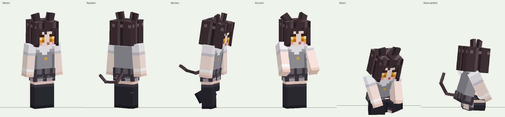

> **Modrinth-Hinweis:** Modrinth benötigt eine gebaute `.jar`-Datei. In dieser ZIP liegt der Quellcode, keine fertige und getestete Mod-JAR. Folge `BUILD_FOR_MODRINTH.txt`, um einen Build über GitHub Actions auszuführen. Minecraft-26.3-Spieltests wurden nicht durchgeführt.

# Catgirl Wolf – Fabric-Mod für Minecraft Java 26.3

Ersetzt den Wolf optisch durch ein spielergroßes Anime-Catgirl mit eigenem 3D-Modell, eigener Sitzpose und Miau-Lauten aus deiner MP3. Die Entity bleibt der **echte Vanilla-Wolf**: Zähmen mit Knochen, Besitzer, Sitzen/Aufstehen, Folgen, Teleportieren zum Besitzer, Angriff, Heilung, Rüstung (Logik), Varianten usw. funktionieren unverändert, weil an der Wolf-Logik nichts geändert wird.



*(Vorschau aus meinem eigenen Python-Renderer mit derselben Modell- und Texturdefinition wie im Java-Code, kein Screenshot aus Minecraft.)*

## Was technisch passiert

| Bereich | Umsetzung |
|---|---|
| Aussehen | Eigener Renderer `CatgirlWolfRenderer` für `EntityType.WOLF`, eigenes Modell `CatgirlWolfModel`. Textur im **Standard-Spielerskin-Format 64×64 (schmale Arme)**, dazu 3D-Ohren und ein Schwanz aus 3 Gliedern |
| Größe | Modell in Spielereinheiten, Skalierung 0,9375 wie beim Spieler → ca. 1,8 Blöcke (+ Ohren). Babys: halb so groß |
| Hitbox | **Geändert** auf 0,6 × 1,8 Blöcke (Augenhöhe 1,62) per Mixin, damit der Kopf nicht in Decken steckt. Folge: Wölfe brauchen jetzt 2 Blöcke Platz nach oben, wie ein Spieler |
| Animationen | Prozedural im Modell (keine Zusatzbibliothek nötig): Leerlauf (Atmen, Ohrzucken, Schwanzwedeln), Gehen/Rennen (Arme, Beine mit Kniegelenk, Schwanz, Haare), eigene Sitzpose, Knurren (Ohren angelegt), Schaden (Zusammenzucken), Tod, Kopfneigen beim Betteln |
| Sounds | `assets/minecraft/sounds.json` ersetzt mit `"replace": true` alle 42 Wolfs-Lautereignisse (7 Sound-Varianten × 6 Ereignisse) plus `entity.wolf.howl` |

### Hierarchie des Modells

```
torso (Hüfte) ─ head (+ Hut-Ebene) ─ left_ear, right_ear
              ├ tail ─ tail_mid ─ tail_tip
              └ right_arm, left_arm (+ Ärmel-Ebene)
right_leg ─ right_shin      left_leg ─ left_shin   (+ Hosen-Ebene)
```

## Deinen eigenen Skin verwenden

Die Mod nimmt einen ganz normalen Minecraft-Skin (64×64, schmale Arme / „Alex“-Format) als Textur.

1. Deine Skin-PNG umbenennen in `catgirl_wolf.png`.
2. Damit die mitgelieferte Datei ersetzen:
   `src/main/resources/assets/catgirlwolf/textures/entity/catgirl_wolf.png`
3. Mod bauen (siehe unten).

Was mit dem Skin passiert:
- Kopf, Hut-Ebene, Körper, Jacke, Arme, Ärmel, Beine und Hosen-Ebene werden 1:1 wie beim Spieler verwendet.
- Die Beine sind am Knie geteilt: obere 6 Pixelzeilen = Oberschenkel, untere 6 = Unterschenkel. Das ist für die Sitzpose nötig.
- **Katzenohren und Schwanz** gibt es im Skinformat nicht. Sie nehmen ihre Pixel aus den Haaren an der Kopfseite (Ohren) bzw. am Hinterkopf (Schwanz) und haben dadurch automatisch die Haarfarbe deines Skins. Falls dein Skin Ohren schon auf den Kopf gemalt hat, siehst du beides.
- Ein Skin im breiten „Steve“-Format funktioniert auch, die Arme verlieren dann aber eine Pixelspalte.

## Audio: Ausschnitte aus der MP3

Die MP3 (16,3 s) wurde mit FFmpeg-`silencedetect` (−40 dB) in 11 Laute zerlegt. Für jeden Laut habe ich Tonhöhenverlauf (Autokorrelation), Lautstärke und Hüllkurve gemessen. **Wichtig:** Ich kann Audio nicht hören. Die Zuordnung beruht auf diesen Messwerten, nicht auf Hörprüfung. Jeder Schnitt hat ca. 30 ms Puffer, 12 ms Ein- und 40 ms Ausblendung gegen Knackser, Normalisierung auf ca. −3 dB Spitze, Ausgabe als Mono-OGG Vorbis 44,1 kHz (Mono ist für Positions-Audio in Minecraft nötig).

| Datei | Zeit in MP3 | Dauer | Ereignis | Messbefund |
|---|---|---|---|---|
| meow_idle_1.ogg | 0,99–1,67 s | 0,68 s | ambient | helles „nya~“, Tonhöhe ca. 400→750→420 Hz |
| meow_growl_1.ogg | 2,03–3,45 s | 1,42 s | growl | beginnt tief (240–300 Hz), steigt dann an – tiefster Laut der Aufnahme |
| meow_idle_2.ogg | 3,88–4,52 s | 0,64 s | ambient, hurt (Tonhöhe 1,12) | hohes kurzes „nya“, 600–660 Hz, fallend |
| meow_whine_1.ogg | 5,19–5,49 s | 0,30 s | whine | sehr leise, kurz, fallend 440→350 Hz |
| meow_bark_1.ogg | 5,61–6,27 s | 0,66 s | ambient („Bellen“) | energisch, schneller Anstieg auf ca. 700 Hz |
| meow_death_1.ogg | 7,31–8,39 s | 1,08 s | death | lang, langsam abfallend 580→350 Hz, wird leiser |
| meow_whine_2.ogg | 8,70–9,06 s | 0,36 s | whine, pant (leise) | leise, flach um 345 Hz |
| meow_pant_1.ogg | 9,27–9,56 s | 0,29 s | pant | stimmloser Hauch, keine Tonhöhe messbar |
| meow_hurt_1.ogg | 10,24–10,81 s | 0,57 s | hurt | lautester Laut, schneller Ansatz bei ca. 760 Hz, abrupter Abfall |
| meow_howl_1.ogg | 11,47–14,07 s | 2,60 s | howl | längster Laut, steigt 315→450 Hz, klingt zweiteilig aus |
| meow_idle_3.ogg | 14,59–15,19 s | 0,60 s | ambient („Bellen“) | hell, Anstieg auf ca. 670 Hz |

Hinweise zur Zuordnung:

- **Bellen:** Minecraft hat kein eigenes Bell-Ereignis. Das Bellen ist Teil von `entity.wolf.ambient`. Deshalb mischt der Ambient-Pool ruhige Miaus (idle 1–3) mit den energischen Lauten (bark_1, idle_3). Wolfsbellen ist damit vollständig ersetzt.
- **Knurren:** Die Aufnahme enthält nur einen wirklich tiefen Laut. Die zweite Variante ist derselbe Ausschnitt mit tieferer Tonhöhe (0,84) – das ist ehrlich gesagt keine eigene Aufnahme.
- **Hecheln:** Es gibt einen stimmlosen Atemlaut (pant_1). Vanilla spielt „pant“ bei gezähmten Wölfen recht oft, deshalb ist er leiser gemischt.
- **Heulen:** `entity.wolf.howl` wird in Vanilla nach meinem Kenntnisstand kaum oder gar nicht abgespielt. Es ist trotzdem ersetzt, damit garantiert kein Original zu hören ist.
- Schritte, Fellschütteln und Wolfsrüstungs-Geräusche bleiben Vanilla (nicht vokal).

## Installation (Modrinth App)

1. Modrinth App öffnen → Profil mit **Minecraft 26.3** und **Fabric Loader 0.19.5** (oder neuer) anlegen bzw. auswählen.
2. Im Profil unter *Content* → **Fabric API** für 26.3 installieren (getestet habe ich die Versionsangaben gegen 0.165.0+26.3).
3. Die gebaute `catgirl-wolf-1.0.0.jar` in den `mods`-Ordner des Profils legen (in der App: Profil → ⋯ → *Open folder* → `mods`).
4. **Altes Resourcepack deaktivieren**, falls es Wolfstextur oder Wolfssounds ersetzt. Resourcepacks haben Vorrang vor Mod-Ressourcen und würden die Laute oder das Aussehen überdecken. Ein separates Resourcepack ist für diese Mod nicht nötig, alles steckt in der JAR.
5. Für Multiplayer: Die Mod muss **auch auf dem Server** installiert sein, sonst stimmt die Hitbox nicht. Aussehen und Sounds sind rein clientseitig.

## Bauen

Ich konnte die JAR nicht bauen (siehe „Test-Status“). So baust du sie selbst:

1. **JDK 25** installieren (z. B. Temurin 25). Minecraft 26.x verlangt Java 25.
2. **Gradle 9.6.0** wird benötigt. Am einfachsten: Projektordner in **IntelliJ IDEA** öffnen, IntelliJ lädt Gradle anhand von `gradle/wrapper/gradle-wrapper.properties` selbst. Alternativ mit installiertem Gradle einmal `gradle wrapper --gradle-version 9.6.0` im Projektordner ausführen, danach gibt es `gradlew`.
3. `./gradlew build` (Windows: `gradlew.bat build`).
4. Ergebnis: `build/libs/catgirl-wolf-1.0.0.jar` (nicht die `-sources.jar`).
5. Zum direkten Testen: `./gradlew runClient`.

Falls Gradle meldet, dass `1.17-SNAPSHOT` von Loom nicht gefunden wird: auf <https://fabricmc.net/develop/> die aktuelle Loom-Version für 26.3 nachsehen und in `gradle.properties` eintragen.

## Im Spiel prüfen

1. `/summon minecraft:wolf` → Catgirl steht da, ca. so groß wie du.
2. Mit Knochen zähmen → Herzpartikel, sie folgt dir.
3. Rechtsklick → Sitzpose (kniend, Hände vorn, Kopf schief). Nochmal Rechtsklick → steht auf.
4. Wegrennen → Lauf- und Rennanimation; weit weg teleportieren → sie teleportiert nach.
5. Leicht schlagen (Überlebensmodus, nicht gezähmt) → Schaden-Laut, Ohren legen sich an, danach Knurren.
6. Untertitel einschalten (Optionen → Zugänglichkeit): es sollten „Catgirl miaut“, „Catgirl faucht“ usw. erscheinen, kein „Wolf bellt“.
7. Mit `/playsound minecraft:entity.wolf_angry.ambient master @s` und den anderen Varianten (`wolf_big`, `wolf_cute`, `wolf_grumpy`, `wolf_puglin`, `wolf_sad`) gegenprüfen, dass überall Miaus kommen.

## Test-Status (ehrlich)

| Geprüft | Ergebnis |
|---|---|
| Versionen 26.3 / Loader 0.19.5 / Loom 1.17 / Gradle 9.6.0 / Fabric API 0.165.0+26.3 | gegen offizielle Fabric-Quellen recherchiert |
| Namen der Wolf-Lautereignisse | gegen Mappings recherchiert (7 Sets × 6 Ereignisse) |
| Audio-Schnitte | gemessen, nicht angehört |
| Textur passt zum Modell (UV) | Standard-Skin-Layout; mit der mitgelieferten Standardtextur gerendert und geprüft |
| Posen (Stehen, Rennen, Sitzen, Knurren) | im eigenen Vorschau-Renderer geprüft |
| Java-Code | kompiliert fehlerfrei gegen **selbstgeschriebene Platzhalter-Klassen**. Das prüft Syntax und Typen meines Codes, aber **nicht**, ob die Minecraft-26.3-Methoden genau so heißen |
| Echter Gradle-Build gegen Minecraft 26.3 | **nicht** möglich (kein Internetzugang in meiner Umgebung, nur Java 21) |
| Spielstart, Zähmen, Sitzen, Sounds im Spiel | **nicht getestet** |

Die riskantesten Stellen, falls der Build Fehler meldet: Feldnamen in `WolfRenderState` und `LivingEntityRenderState` (z. B. `hasRedOverlay`, `deathTime`, `isBaby`), `EntityRenderers.register`, und der Mixin auf `getDefaultDimensions`. Der Mixin hat `require = 0`: Passt er nicht, startet das Spiel trotzdem, nur bleibt die kleine Wolfs-Hitbox.

## Bekannte Einschränkungen

- Halsband-Farbe wird nicht angezeigt.
- Haare, Rock und Schleife sind flach im Skin gemalt, nicht als eigene 3D-Teile (das Skinformat hat dafür keinen Platz).
- Wolfsrüstung funktioniert, wird aber nicht gezeichnet.
- Die Hitbox bleibt im Sitzen 1,8 hoch (Vanilla-Wölfe ändern beim Sitzen ihre Pose nicht).
- Fell-Schütteln nach Wasser hat keine eigene Animation.
- Babys sind kleine Catgirls (halbe Größe).

## Lizenz und Veröffentlichung

Code: MIT. Die Laute stammen aus einer Aufnahme von „Soundees“. Bevor du die Mod öffentlich auf Modrinth hochlädst, prüfe deren Lizenz. Die mitgelieferte Standardtextur ist eine eigene Pixel-Art nach deiner Beschreibung. Wenn du einen fremden Skin einsetzt (z. B. eine bekannte Anime-Figur), darfst du die Mod damit nicht öffentlich veröffentlichen.

### Vorschlag für die Modrinth-Projektseite

**Name:** Catgirl Wolf
**Kurzbeschreibung:** Wölfe werden zu spielergroßen Anime-Catgirls – mit Sitzpose, Animationen und Miau-Lauten.
**Kategorien:** Mobs, Decoration
**Umgebung:** Client und Server (Hitbox), clientseitig allein funktioniert die Optik
**Beschreibung:**
> Ersetzt das Aussehen und alle Laute des Wolfs durch ein Catgirl in Schuluniform. Zähmen, Sitzen, Folgen und Kämpfen bleiben vollständig Vanilla. Eigenes 3D-Modell mit Ohren, Schwanz, Haaren und Kniegelenken, eigene Sitzpose, Lauf- und Leerlaufanimationen. Benötigt Fabric API.

## Projektstruktur

```
build.gradle, settings.gradle, gradle.properties, gradle/wrapper/gradle-wrapper.properties
src/main/java/de/catgirlwolf/CatgirlWolf.java                 Einstieg, Hitbox-Maße
src/main/java/de/catgirlwolf/mixin/LivingEntityDimensionsMixin.java
src/main/java/de/catgirlwolf/client/CatgirlWolfClient.java     Registrierung
src/main/java/de/catgirlwolf/client/CatgirlWolfRenderer.java
src/main/java/de/catgirlwolf/client/CatgirlWolfModel.java      Modell + Animationen
src/main/resources/fabric.mod.json, catgirlwolf.mixins.json
src/main/resources/assets/catgirlwolf/textures/entity/catgirl_wolf.png   ← hier kommt dein Skin hin
src/main/resources/assets/catgirlwolf/sounds/*.ogg (11 Dateien)
src/main/resources/assets/catgirlwolf/lang/de_de.json, en_us.json (Untertitel)
src/main/resources/assets/minecraft/sounds.json               ersetzt alle Wolfslaute
tools/spec_skin.py     Modell im Skin-Layout (erzeugt Standardtextur + Java-Layer-Code)
tools/spec.py          Farben und Maler der Standardtextur
tools/preview.py       Vorschau-Renderer
tools/audio_schneiden.py  die FFmpeg-Schnitte (erwartet full.wav = MP3 als Mono-WAV)
```

Die Textur kannst du mit jedem Skin-Editor bearbeiten (z. B. Blockbench, NovaSkin oder Tynker), weil sie ein normaler Spielerskin ist.
